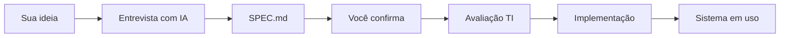

# Comece Aqui — BPM Pré-Moldados

Este guia é para **funcionários** que querem transformar uma ideia em aplicação interna usando este template e ferramentas de IA.

> **Primeiro passo?** Se você ainda **não tem um repositório só seu** (cópia do molde), leia antes: [`Docs/projeto/COMO-CRIAR-SEU-PROJETO.md`](./Docs/projeto/COMO-CRIAR-SEU-PROJETO.md).  
> **Não commite** no repositório oficial `projeto-padrao-bpm` — trabalhe sempre na **cópia** do seu projeto.

---

## O que é este repositório?

Um **molde padronizado** — não um sistema pronto para usar.

Ele oferece:

- Documentação para a IA seguir um processo correto
- Design visual da BPM (cores, logo, componentes)
- Stack e convenções de código já definidas
- Código de **referência** (login, dashboard, BFF) para sistemas internos

**Você não precisa saber programar** para começar a conversa com a IA. Mas **precisa passar pelo processo** abaixo antes de considerar qualquer coisa “pronta”.

---

## O processo (obrigatório)



### 1. Descreva sua ideia — mas não peça código ainda

*(Opcional: organize antes com [`Docs/projeto/FORMULARIO-RASCUNHO-NEGOCIO.md`](./Docs/projeto/FORMULARIO-RASCUNHO-NEGOCIO.md).)*

Abra o projeto no **Cursor** ou **Claude Code** e explique o que você precisa em linguagem simples.

Exemplos bons:

- “Preciso acompanhar pedidos de clientes do setor comercial”
- “Quero um painel com produção do dia e metas da semana”
- “Preciso de uma página para captar leads de um evento”

Exemplos ruins:

- “Faz um sistema completo de ERP”
- “Cria tudo agora”
- “Igual ao SAP mas melhor”

A IA deve conduzir a **entrevista** descrita em `Docs/entrevista/INTERVIEW.md` — uma pergunta por vez, com hipótese e nível de confiança.

### 2. Confirme o SPEC antes de qualquer código

Quando a entrevista atingir ~95% de confiança, a IA gera um **`SPEC.md`** na raiz do projeto:

- O que **será** construído na primeira versão
- O que **não será** construído (fora do escopo)
- Telas, dados, integrações e critérios de sucesso

**Leia com atenção.** Só diga “confirmo” se estiver de acordo. Ajustes são normais — melhor agora do que depois de semanas de código.

Guia da IA: `Docs/skills/SPEC-DRIVEN.md`

### 3. Avaliação do TI

Mesmo com SPEC aprovado por você, a **equipe de TI da BPM** avalia:

- Viabilidade técnica e segurança
- Integrações com sistemas existentes (TOTVS, e-mail, etc.)
- Impacto em infraestrutura e dados
- Prioridade frente a outros projetos

Checklist formal: [`Docs/projeto/APROVACAO-TI.md`](./Docs/projeto/APROVACAO-TI.md)

**Nem toda ideia vira sistema imediatamente.** Isso é esperado e faz parte do processo. A IA só implementa depois que a TI aprovar (ou confirmar que já aprovou).

**Opcional antes da entrevista:** preencha [`Docs/projeto/FORMULARIO-RASCUNHO-NEGOCIO.md`](./Docs/projeto/FORMULARIO-RASCUNHO-NEGOCIO.md) para organizar suas ideias.

### 4. Implementação incremental

Só depois das etapas acima a IA implementa, **passo a passo**, com sua confirmação entre cada etapa.

Guia: `Docs/skills/INCREMENTAL.md`

---

## O que NÃO fazer

| Evitar | Por quê |
|---|---|
| Pedir “faz tudo de uma vez” | Gera escopo errado e difícil de corrigir |
| Pular a entrevista | A IA constrói o que você pediu, não o que você precisa |
| Ignorar “fora do escopo” no SPEC | Metade dos mal-entendidos vem daí |
| Assumir que login/Postgres existem em todo projeto | São **referência** para sistemas internos; landing pages e protótipos podem ser bem mais simples |
| Publicar ou compartilhar fora da BPM sem TI | Dados e acessos precisam de avaliação |
| Clonar e commitar no molde `projeto-padrao-bpm` | Use **seu** repo — ver [COMO-CRIAR-SEU-PROJETO.md](./Docs/projeto/COMO-CRIAR-SEU-PROJETO.md) |

---

## Tipos de projeto

A entrevista identifica um de três cenários:

| Tipo | Exemplo | Backend necessário? |
|---|---|---|
| **Landing page** | Página de evento, captação de leads | Geralmente não |
| **Dashboard** | Painel de métricas de produção | Depende da fonte de dados |
| **Sistema interno** | Cadastro de pedidos, fluxo de aprovação | Frequentemente sim |

Cenários detalhados: `Docs/entrevista/scenarios/`

---

## Ambiente de desenvolvimento

### Pré-requisitos

- [Node.js 22 LTS](https://nodejs.org/) (ou última LTS)
- Editor: [Cursor](https://cursor.com) ou terminal com Claude Code
- Git (opcional no início; TI pode orientar)

### Subir o template localmente

Na **raiz** (frontend + backend em paralelo):

```bash
npm run setup
npm install
npm run dev
```

O comando `npm run setup` cria `frontend/.env.local` e `backend/.env` a partir dos `.env.example` (se ainda não existirem).

Configure manualmente se preferir:

- `frontend/.env.local` — `BACKEND_URL=http://localhost:3001`
- `backend/.env` — ver `backend/.env.example`

**Alternativa — terminais separados:**

```bash
npm run dev:backend   # porta 3001
npm run dev:frontend  # porta 3000
```

Abra [http://localhost:3000](http://localhost:3000)

**Telas do SIG BPM:** depois do login, a ferramenta abre em `/competencias`, a lista dos meses com os atalhos de cada etapa (importações, classificação, lançamentos, listas, receita, rateios, estoque, DRE e conferência com a planilha). As telas de demonstração do molde (dashboard, pedidos e exemplos) foram removidas na revisão final (Passo 28). As telas estão descritas na seção "Telas e Fluxos" do SPEC.

| Rota | O que mostra |
|---|---|
| [`/api/docs`](http://localhost:3001/api/docs) (backend) | Swagger — documentação interativa da API |

Mensagens prontas: [`Docs/projeto/MENSAGENS-PRONTAS.md`](./Docs/projeto/MENSAGENS-PRONTAS.md)  
Checklist de piloto: [`Docs/projeto/PILOTO-CHECKLIST.md`](./Docs/projeto/PILOTO-CHECKLIST.md)

### Primeiro acesso

O login é pelos usuários do banco (Passo 22 do SPEC do SIG BPM). A carga inicial (`backend/prisma/carga-inicial.ts`) cria o usuário inicial, com o perfil Contábil:

| Campo | Valor |
|---|---|
| E-mail | `admin@bpm.com` |
| Senha | `admin123` — troque no primeiro acesso, pelo menu do usuário |

Os demais usuários e os perfis são cadastrados nas telas **Usuários** e **Perfis** (menu Administração).

---|---|
| E-mail | `admin@bpm.com` |
| Senha | `admin123` |

Isso funciona **sem banco de dados** configurado. Quando o SPEC do *seu* projeto definir usuários reais, o TI orienta a conexão com PostgreSQL — não é passo automático ao clonar o template.

---

## Trabalhando com a IA

### Abrir o projeto

1. Tenha uma **cópia** do molde no **seu** repositório GitHub — [COMO-CRIAR-SEU-PROJETO.md](./Docs/projeto/COMO-CRIAR-SEU-PROJETO.md)
2. Clone **seu** repo (ou peça à TI para abrir no Cursor)
3. Abra a pasta raiz no Cursor
4. A IA lê `AGENTS.md` e segue o fluxo documentado

### Primeira mensagem sugerida

> “Tenho uma ideia de [descreva em 2–3 frases]. Quero começar pela entrevista do template BPM antes de qualquer código.”

A IA deve carregar `Docs/entrevista/INTERVIEW.md` e **não** começar a codar.

### Durante o projeto

- Confirme cada passo da implementação
- Peça para atualizar o SPEC se o escopo mudar
- Use `Docs/skills/CODE-REVIEW.md` antes de considerar uma feature pronta

---

## Estrutura do que você vai ver no código

| Pasta | O que é |
|---|---|
| `frontend/` | Interface (Next.js) — onde ficam as telas |
| `backend/` | API (Express) — só se o SPEC prever |
| `Docs/` | Regras fixas da BPM — **não apague** |
| `SPEC.md` | Contrato do *seu* projeto (criado na entrevista) |

O dashboard e o login que você vê ao rodar localmente são **placeholder** — serão substituídos ou removidos conforme o SPEC do seu projeto.

---

## Identidade visual

Toda interface deve seguir `Docs/design-system/DESIGN-SYSTEM.md`:

- Cores BPM (amarelo `#FFCC00`, preto `#111111`)
- Logo oficial em `frontend/public/logo-bpm.svg`
- Componentes shadcn/ui + Tailwind

A IA já está instruída a respeitar isso. O molde inclui a **skill oficial shadcn** (`.agents/skills/shadcn/`) para ajudar a instalar e compor componentes — sem substituir o design system BPM.

---

## Dúvidas frequentes

**Preciso configurar PostgreSQL para começar?**  
Não. Só se o SPEC do seu projeto e o TI definirem banco de dados.

**Posso remover o login?**  
Sim, se o SPEC for landing page ou protótipo interno sem auth. A IA ajusta conforme `Docs/stack/CONVENTIONS.md`.

**Quem aprova meu projeto?**  
Você confirma o SPEC; a TI preenche [`Docs/projeto/APROVACAO-TI.md`](./Docs/projeto/APROVACAO-TI.md) antes do desenvolvimento.

**Posso usar outras tecnologias?**  
Exceções devem estar no SPEC e ser aprovadas pelo TI. O padrão está em `Docs/stack/STACK.md`.

**Preciso clonar o GitHub?**  
Não necessariamente — peça à TI um repo novo ou use **Use this template**. Detalhes: [`COMO-CRIAR-SEU-PROJETO.md`](./Docs/projeto/COMO-CRIAR-SEU-PROJETO.md).

---

## Próximos passos

1. [Crie ou peça seu repositório](./Docs/projeto/COMO-CRIAR-SEU-PROJETO.md) (cópia do molde)
2. Leia este documento
3. Configure o ambiente (se quiser ver o template rodando)
4. Abra o Cursor e inicie a **entrevista** — não a implementação
5. Aguarde avaliação do TI após SPEC confirmado

Documentação técnica completa: [README.md](./README.md)
