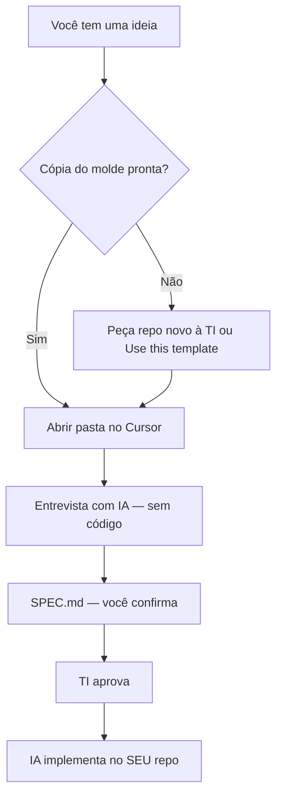

# Como criar o seu projeto a partir do molde

> **Para funcionários** do administrativo, comercial, produção, etc. — **não** para a equipe de TI que mantém o molde.

Este guia explica **como sair do zero até a entrevista com a IA**, sem mexer no repositório oficial do template.

---

## Antes de tudo: dois repositórios diferentes

| Repositório | O que é | Você commita aqui? |
|---|---|---|
| **`projeto-padrao-bpm`** | Molde oficial da BPM (documentação + código de referência) | **Não** |
| **`dashboard-vendas`**, **`painel-producao`**, etc. | **Seu** projeto, cópia do molde | **Sim** (com TI) |

Pense no molde como **formulário em branco da empresa**. Você **copia** o formulário para a sua pasta — não escreve em cima do original.

**URL do molde (referência):** https://github.com/bpmghb/projeto-padrao-bpm

---

## Fluxo em uma imagem



Detalhes do processo: [COMECE-AQUI.md](../../COMECE-AQUI.md)

---

## Caminho 1 — Você não sabe Git (recomendado para leigos)

**Peça à TI** (ou ao “champion” de tecnologia da sua área):

1. Nome do sistema (ex.: “Dashboard Comercial”)
2. Descrição em 2–3 frases do que precisa
3. Quem vai usar

A TI:

- Cria um **repositório novo** a partir do molde
- Te dá **acesso** no GitHub
- Opcional: instala Cursor e clona o repo **no seu computador**

**Você só precisa:**

1. Abrir a pasta do **seu** projeto no Cursor
2. Enviar a primeira mensagem (modelo abaixo)
3. Responder a entrevista e confirmar o SPEC

Não precisa saber `git clone` neste caminho.

---

## Caminho 2 — “Use this template” no GitHub (quem tem acesso à org)

Se a TI marcou o molde como **Template repository** no GitHub:

1. Abra https://github.com/bpmghb/projeto-padrao-bpm
2. Clique em **Use this template** → **Create a new repository**
3. Nome sugerido: `bpmghb/dashboard-[sua-area]-[ano]` (ex.: `dashboard-comercial-2026`)
4. Deixe **Private**
5. Crie o repositório

Depois, no **Git Bash** (se TI ou colega orientar):

```bash
cd /c/Users/SEU_USUARIO/projetos
git clone https://github.com/bpmghb/SEU-REPO-NOVO.git
cd SEU-REPO-NOVO
npm run setup
npm install
npm run dev
```

Abra a pasta **`SEU-REPO-NOVO`** no Cursor (File → Open Folder).

> Se `npm` der erro, peça ajuda à TI — Node.js 22 precisa estar instalado.

---

## Caminho 3 — TI mantém o molde (instrução para TI)

Para habilitar o **Caminho 2** para todos:

1. GitHub → `projeto-padrao-bpm` → **Settings**
2. Marque **Template repository**
3. Comunique o link do molde às áreas

Ao criar repo para um solicitante, a TI pode usar **Use this template** ou duplicar manualmente — **nunca** dá write no molde original para usuários de negócio.

---

## Exemplo: “Quero um dashboard de produção”

### O que você descreve (antes da IA)

- Quem olha o painel? (ex.: supervisores do chão de fábrica)
- Quais números importam? (produção do dia, meta, refugo, etc.)
- De onde vêm os dados hoje? (planilha, TOTVS, plano manual)
- Com que frequência atualiza? (tempo real, fim do turno, diário)

Opcional: preencha [FORMULARIO-RASCUNHO-NEGOCIO.md](./FORMULARIO-RASCUNHO-NEGOCIO.md)

### O que **não** pedir na primeira mensagem

- “Clona o GitHub e faz o dashboard completo”
- “Igual ao Power BI da diretoria”
- “Com login, banco e TOTVS já integrado”

### Primeira mensagem no Cursor (copie e adapte)

```
Tenho uma ideia de dashboard para [ÁREA]: [2–3 frases do problema].

Este repositório é a CÓPIA do template BPM (não é o molde oficial).
Quero começar pela entrevista em Docs/entrevista/INTERVIEW.md —
tipo dashboard — sem escrever código ainda.
```

### O que acontece depois

| Etapa | Sua ação |
|---|---|
| Entrevista | Responder uma pergunta por vez |
| SPEC | Ler, pedir ajustes, dizer **confirmo** |
| TI | Aguardar aprovação ([APROVACAO-TI.md](./APROVACAO-TI.md)) |
| Implementação | Confirmar cada passo com a IA |
| Ver no navegador | `npm run dev` → http://localhost:3000 |

Referência visual no molde: `/dashboard` (KPIs e gráfico de exemplo).

---

## O que NÃO fazer

| Errado | Certo |
|---|---|
| Clonar `projeto-padrao-bpm` e commitar lá | Trabalhar só no **seu** repositório |
| Pedir código antes do SPEC | Entrevista → SPEC → TI → código |
| Apagar pasta `Docs/` | Manter — a IA depende dela |
| Compartilhar repo privado fora da BPM | Falar com TI |
| Assumir que login e Postgres são obrigatórios | Dashboard pode ser só leitura; SPEC define |

---

## Git — só o mínimo (se precisar)

| Comando | Quando usar |
|---|---|
| `git clone URL` | Baixar **seu** repo pela primeira vez |
| `git status` | Ver o que mudou (TI pode mostrar) |
| `git add .` + `git commit -m "..."` | Salvar versão local |
| `git push` | Enviar para o GitHub |

**Commits no molde `projeto-padrao-bpm`:** apenas **TI** (melhorias no template).

**Commits no seu repo:** você + TI, após SPEC aprovado.

Se não quiser usar Git: TI ou colega faz o push por você; você foca na conversa com a IA.

---

## Checklist — “estou pronto para começar?”

- [ ] Tenho um repositório **meu** (não o molde oficial)
- [ ] Pasta aberta no **Cursor**
- [ ] (Opcional) `npm run setup`, `npm install` e `npm run dev` funcionando
- [ ] Sei em 2–3 frases **qual problema** quero resolver
- [ ] Li que o processo é: **entrevista → SPEC → TI → código**

---

## Troubleshooting

| Sintoma | Solução |
|---|---|
| `node: command not found` | Instalar Node.js **22+** ([nodejs.org](https://nodejs.org)) ou pedir à TI |
| `EADDRINUSE` porta 3000/3001 | Outro processo usando a porta — fechar terminal antigo ou `npx kill-port 3000 3001` |
| `Permission denied` no `git push` | `gh auth login` ou pedir acesso write ao repo à TI |
| `Repository not found` (clone) | Repo privado — autenticar no GitHub |
| Frontend sobe, backend não | Verificar `backend/.env` (rode `npm run setup`) |
| Login não funciona | Backend rodando? `ENABLE_TEMPLATE_AUTH=true` em dev |
| Turbopack / HMR estranho | O molde usa `next dev --webpack` — normal |
| `Cannot find module react` em `frontend/node_modules` | Apague `frontend/node_modules` e rode `npm install` **na raiz** (não dentro de `frontend/`) |

Mensagens prontas para o Cursor: [MENSAGENS-PRONTAS.md](./MENSAGENS-PRONTAS.md)  
Checklist de piloto: [PILOTO-CHECKLIST.md](./PILOTO-CHECKLIST.md)

---

## Precisa de ajuda?

| Situação | Quem acionar |
|---|---|
| Criar repositório / permissão GitHub | TI |
| Instalar Node, Cursor, clone | TI ou champion da área |
| Dúvida sobre o processo (SPEC, entrevista) | [COMECE-AQUI.md](../../COMECE-AQUI.md) |
| Aprovar desenvolvimento | TI — [APROVACAO-TI.md](./APROVACAO-TI.md) |

---

## Próximo passo

Abra o Cursor no **seu** repositório e inicie a entrevista — não a implementação.

Guia completo: [COMECE-AQUI.md](../../COMECE-AQUI.md)
