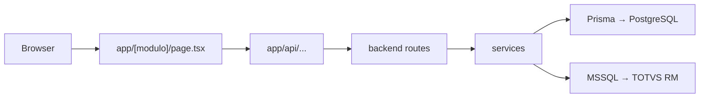

# BPM — Convenções de Código

Este documento define **como organizar e escrever código** nos projetos do template BPM.

- **Stack (com o quê):** `Docs/stack/STACK.md`
- **Visual (como parece):** `Docs/design-system/DESIGN-SYSTEM.md`
- **Escopo do projeto (o quê construir):** `SPEC.md` na raiz

---

## Regras gerais

### TypeScript

- Apenas arquivos `.ts` e `.tsx` — **nunca** `.js` ou `.jsx`
- Evitar `any`; usar `unknown` + narrowing ou tipos inferidos do Zod (`z.infer<typeof schema>`)
- Props de componentes sempre tipadas explicitamente

### Nomenclatura

| O quê | Padrão | Exemplo |
|---|---|---|
| Pastas de domínio / feature | português, kebab-case | `pedidos/`, `ordens-producao/` |
| Arquivos de domínio | português ou inglês consistente por pasta | `pedidosService.ts`, `pedidosController.ts` |
| Infraestrutura técnica | inglês | `errorHandler.ts`, `queryClient.ts` |
| Componentes React | PascalCase | `PedidosTable.tsx` |
| Hooks | camelCase com prefixo `use` | `usePedidos.ts` |
| Schemas Zod | camelCase + sufixo `Schema` | `criarPedidoSchema` |
| Constantes | UPPER_SNAKE_CASE | `STATUS_PEDIDO` |

**Regra:** dentro de um mesmo módulo, não misturar português e inglês nos nomes de arquivos.

### Prisma

- **Um único `schema.prisma` por projeto** — em `frontend/prisma/` ou `backend/prisma/`, conforme o `SPEC.md`
- Nunca duplicar schema nos dois pacotes
- Migrations versionadas no mesmo pacote do schema

### Acesso a dados

| Banco | Ferramenta | Onde |
|---|---|---|
| PostgreSQL (SG — sistema principal) | Prisma | `frontend/` ou `backend/` |
| SQL Server (TOTVS RM) | driver MSSQL dedicado | apenas `backend/` |
| Cache / sessão | Redis | apenas `backend/` |

Não usar pool `pg` manual no mesmo banco já coberto pelo Prisma.

---

## Arquitetura: como as partes se conectam



**Regra de ouro:** o browser **não** chama o Express diretamente.

1. Componentes e hooks usam `axios` de `lib/api.ts`
2. `axios` aponta para rotas **`/api/...`** do Next.js (BFF)
3. O BFF valida sessão/token e repassa ao Express via `app/api/proxy/[...path]/`

Exceção: projetos **somente frontend** (landing, CRUD simples) podem usar Server Actions + Prisma sem Express — definir no `SPEC.md`.

---

## Frontend (`frontend/src/`)

### Variantes de estrutura

| Tipo de projeto | Estrutura |
|---|---|
| `sistema-interno` | Com auth, proxy, BFF e `ProtectedLayout` |
| `dashboard` | Igual ao sistema interno, ou somente frontend se não houver Express |
| `landing-page` | Sem proxy global de auth, sem `ProtectedLayout`, sem BFF/proxy |

---

### Estrutura padrão — sistema autenticado

```
src/
├── proxy.ts                      ← proteção global de rotas (redirect para login)
├── providers.tsx                 ← QueryClientProvider e demais providers
│
├── app/
│   ├── layout.tsx                ← HTML, fontes, Providers
│   ├── page.tsx                  ← página inicial (ex.: redirect para /dashboard)
│   ├── globals.css
│   │
│   ├── api/                      ← BFF do Next.js
│   │   ├── auth/                 ← login, logout, me, refresh-token
│   │   └── proxy/[...path]/     ← proxy genérico para o backend Express
│   │
│   ├── auth/
│   │   └── login/
│   │       └── page.tsx          ← única rota pública (além de assets)
│   │
│   ├── dashboard/
│   │   └── page.tsx
│   │
│   └── pedidos/                  ← módulo fixo (NÃO usar [modulo] como placeholder)
│       └── listagem/
│           ├── page.tsx          ← Server Component: composição da tela
│           ├── components/       ← componentes exclusivos da feature
│           │   ├── PedidosContent.tsx
│           │   ├── PedidosTable.tsx
│           │   ├── PedidosModal.tsx
│           │   └── PedidosFiltros.tsx
│           ├── hooks/
│           │   └── usePedidos.ts
│           ├── services/
│           │   └── pedidosService.ts
│           └── utils/
│               ├── columns.tsx       ← colunas TanStack Table
│               ├── formatters.ts
│               └── constants.ts
│
├── components/
│   ├── ui/                       ← shadcn/ui (gerado pelo CLI — customizar com cuidado)
│   ├── layout/
│   │   ├── Header.tsx
│   │   ├── Sidebar.tsx
│   │   └── ProtectedLayout.tsx   ← Header + Sidebar + children
│   └── shared/                   ← componentes reutilizáveis da BPM
│       ├── DataTable.tsx
│       ├── PermissionGuard.tsx
│       └── LoadingSkeleton.tsx
│
├── context/
│   ├── AuthContext.tsx           ← usuário logado
│   └── PermissionContext.tsx     ← permissões / RBAC na UI
│
├── hooks/
│   ├── useDebounce.ts
│   └── useRegistrarAcessoTela.ts
│
├── lib/
│   ├── api.ts                    ← axios + interceptors (baseURL → /api)
│   └── queryClient.ts            ← configuração TanStack Query
│
├── services/
│   └── authService.ts            ← funções globais de autenticação
│
└── utils/
    └── formatters.ts             ← CPF, CNPJ, moeda (globais)
```

### Estrutura padrão — landing page (público)

```
src/
├── app/
│   ├── layout.tsx
│   ├── page.tsx
│   ├── globals.css
│   └── api/                      ← apenas se houver formulário (ex.: lead capture)
│       └── leads/
│
├── components/
│   ├── ui/                       ← shadcn
│   └── sections/                 ← Hero, FAQ, CTA, etc.
│
└── lib/
```

Sem `proxy.ts` de auth, sem `context/AuthContext`, sem `app/api/proxy/`.

---

### Rotas no App Router

- Pastas de módulo são **nomes fixos**: `pedidos/`, `clientes/`, `estoque/`
- Colchetes `[]` apenas para parâmetros reais:
  - `pedidos/[id]/page.tsx` → detalhe de um pedido
  - `pedidos/[id]/editar/page.tsx` → edição
- **Não** usar `app/[modulo]/` como placeholder genérico — isso cria rota dinâmica indesejada

### Server Components vs Client Components

| Arquivo | Padrão | Quando usar `"use client"` |
|---|---|---|
| `page.tsx` | Server Component | Nunca, salvo exceção rara |
| `[Feature]Content.tsx` | Client Component | Tabelas, modais, formulários, interatividade |
| `components/ui/*` | Client (shadcn) | Já vem do CLI |
| `layout.tsx` | Server Component | Providers em `providers.tsx` separado |

**Fluxo típico de uma tela:**

```tsx
// page.tsx — Server Component
export default async function PedidosPage() {
  return (
    <ProtectedLayout>
      <PedidosContent />
    </ProtectedLayout>
  );
}
```

```tsx
// PedidosContent.tsx
"use client";
// hooks, React Query, tabela, filtros
```

### Cache Components (Next.js 16)

Habilitado em `next.config` com `cacheComponents: true`. Referência: [Caching](https://nextjs.org/docs/app/getting-started/caching).

| Cenário | Padrão |
|---|---|
| Dados compartilhados que mudam pouco | `"use cache"` + `cacheLife()` em `lib/` ou Server Component |
| Dados por request (auth, cookies) | `await connection()` + **sem** `"use cache"` |
| API Routes / BFF | `await connection()` no início — sempre dinâmico |
| UI que depende de runtime | `<Suspense>` + fallback (skeleton) |
| Formulários e interatividade | Client Component (`"use client"`) |

Exemplo no template: `lib/dashboard.ts` (`use cache`) + `DashboardStats` dentro de `<Suspense>`.

### Páginas de erro (Next.js)

| Arquivo | Uso |
|---|---|
| `app/error.tsx` | Erro recuperável em rotas (botão “Tentar novamente”) |
| `app/not-found.tsx` | 404 — rota inexistente |
| `app/global-error.tsx` | Erro no root layout |
| `components/shared/ErrorPageLayout.tsx` | Layout compartilhado com logo BPM |

Sempre usar logo + tokens BPM. Estados loading/erro/vazio em listagens: skeleton, mensagem vermelha, estado vazio.

### Onde colocar código novo

| O quê | Onde |
|---|---|
| Nova tela / rota | `app/[modulo]/[feature]/page.tsx` |
| Componente usado em uma feature só | `app/.../[feature]/components/` |
| Componente usado em 2+ módulos | `components/shared/` |
| Componente shadcn | `components/ui/` (via CLI) |
| Chamada HTTP ao backend | `app/.../services/` ou `services/` (global) |
| Schema Zod de formulário | junto do form ou `app/.../utils/schemas.ts` |
| Colunas de tabela | `app/.../utils/columns.tsx` |
| Estado de auth / permissão | `context/` |
| Filtros, modal aberto, UI local pesada | Zustand (store por feature ou global leve) |
| Fetch inicial sem interatividade | Server Component (`page.tsx`) |
| Fetch com refetch / polling | TanStack Query no Client Component |

### Context vs Zustand

| Ferramenta | Usar para |
|---|---|
| **React Context** | Auth, permissões — poucos consumidores, muda raramente |
| **Zustand** | Filtros de listagem, estado de modal, preferências de UI |
| **TanStack Query** | Dados do servidor — cache, loading, erro, refetch |

Não duplicar dados do servidor no Zustand se já estão no React Query.

### HTTP no frontend

`lib/api.ts` — configuração única do axios:

- `baseURL: "/api"` (nunca URL do Express no browser)
- Interceptor para token/cookie conforme estratégia de auth
- Tratamento centralizado de 401 → redirect login

`services/` e `app/.../services/` — funções por domínio que chamam `api.get/post/...`.

### Autenticação e permissões

- **`proxy.ts`** — bloqueio coarse-grained (tem sessão? redireciona)
- **`ProtectedLayout`** — shell autenticado (sidebar, header)
- **`PermissionGuard`** — fine-grained (esconde botão / bloqueia ação por permissão)
- **`PermissionContext`** — permissões disponíveis na árvore React

Validação definitiva de permissão: **sempre no backend** (`verificarPermissao`).

Política e matriz de permissões: [`Docs/seguranca/RBAC.md`](../seguranca/RBAC.md).

### UI

- Visual: `Docs/design-system/DESIGN-SYSTEM.md`
- `components/ui/` = shadcn — `button`, `input`, `dialog`, `sonner`, `field`, etc.
- `components/shared/` = composições BPM (`DataTable`, guards, skeletons)
- Estados obrigatórios em listagens: loading (skeleton), erro, vazio
- Sem `ThemeProvider` de dark mode — identidade BPM é light

---

## Backend (`backend/`)

### Estrutura padrão

```
backend/
├── prisma/
│   └── schema.prisma             ← PostgreSQL (SG)
│
└── src/
    ├── server.ts                 ← listen na porta (entry de produção)
    ├── app.ts                    ← monta Express, middlewares e rotas
    │
    ├── config/
    │   ├── env.ts                ← validação de env com Zod
    │   ├── prisma.ts             ← singleton PrismaClient
    │   └── mssql.ts              ← conexão SQL Server (TOTVS RM)
    │
    ├── routes/
    │   ├── authRoutes.ts
    │   └── pedidos/
    │       └── pedidosRoutes.ts
    │
    ├── controllers/
    │   ├── authController.ts
    │   └── pedidos/
    │       └── pedidosController.ts
    │
    ├── services/
    │   ├── totvsService.ts       ← integração SOAP/legado TOTVS
    │   └── pedidos/
    │       └── pedidosService.ts
    │
    ├── schemas/                  ← Zod (validação de request)
    │   └── pedidos/
    │       └── criarPedidoSchema.ts
    │
    ├── middlewares/
    │   ├── autenticacao.ts       ← valida JWT
    │   ├── verificarPermissao.ts ← RBAC
    │   ├── validacao.ts          ← aplica schemas Zod
    │   └── errorHandler.ts       ← handler global
    │
    ├── jobs/
    │   └── sincronizarTotvsJob.ts
    │
    ├── lib/
    │   ├── jwt.ts
    │   └── senha.ts
    │
    └── utils/
        └── logger.ts
```

### Camadas e responsabilidades

| Camada | Responsabilidade | Não deve |
|---|---|---|
| **routes** | Mapear método + path → controller | Lógica de negócio, SQL |
| **controllers** | HTTP in/out, status code, chamar service | Regra de negócio complexa |
| **services** | Regra de negócio, orquestração, Prisma/TOTVS | `req` / `res` do Express |
| **schemas** | Validação Zod de body, query, params | Lógica de negócio |
| **middlewares** | Auth, permissão, validação, erros | Domínio |
| **jobs** | Tarefas agendadas (sync, relatórios) | Responder HTTP |

### Fluxo de uma request

```
routes → autenticacao → verificarPermissao → validacao (Zod) → controller → service → Prisma/MSSQL/Redis
                                                                                        ↓
                                                                              errorHandler (se erro)
```

### Validação

- **Sempre Zod** — nunca Joi
- Schemas em `src/schemas/[dominio]/`
- Tipos exportados: `type CriarPedidoInput = z.infer<typeof criarPedidoSchema>`
- `validacao.ts` aplica o schema e retorna 400 com mensagem clara

### Respostas da API

Formato consistente:

```ts
// Sucesso
{ "data": { ... } }

// Erro de validação (400)
{ "error": "Mensagem legível", "details": [ ... ] }

// Erro interno (500) — sem vazar stack em produção
{ "error": "Erro interno do servidor" }
```

### Integração TOTVS

- Toda comunicação com TOTVS RM em `services/totvsService.ts` (ou sub-serviços chamados por ele)
- **SOAP/WSDL:** lib `soap` — clientes gerados a partir do WSDL do ambiente BPM
- **XML avulso:** `lib/xml.ts` (`xml2js`) — parse/build quando não usar client soap
- **REST JSON:** `axios` — quando a integração expuser HTTP JSON
- Conexão MSSQL isolada em `config/mssql.ts` — consultas diretas ao banco legado
- Nunca espalhar queries ou chamadas TOTVS em controllers

### Documentação da API (Swagger)

- Spec OpenAPI: `backend/src/config/openapi.ts` — atualizar ao criar rotas
- UI interativa: `GET /api/docs` (dev habilitado por padrão)
- JSON exportável: `GET /api/docs.json`
- Controle: `ENABLE_SWAGGER` no `.env` — em produção, habilitar só se TI autorizar (rede interna ou auth)
- Novos endpoints: documentar schemas e responses no `openapi.ts` antes do merge

### Jobs agendados

- Arquivos em `src/jobs/`
- Registrados em `app.ts` ou `server.ts` na inicialização
- Jobs chamam **services** — não duplicar lógica

---

## Onde criar arquivos — checklist rápido

### Nova feature de sistema interno

1. `SPEC.md` — confirmar módulo, entidades, permissões
2. `backend/prisma/schema.prisma` — model (se backend ativo)
3. `backend/src/schemas/...` — validação
4. `backend/src/services/...` — regra de negócio
5. `backend/src/controllers/...` + `routes/...` — API
6. `frontend/src/app/[modulo]/[feature]/page.tsx` — tela
7. `frontend/src/app/.../services/` — chamadas ao BFF
8. `frontend/src/app/.../components/` — UI da feature

### Nova landing page

1. **Referência no template:** `frontend/src/app/exemplo/landing/` (pública, sem auth)
2. Em projetos reais: `frontend/src/app/page.tsx` + `components/sections/`
3. `frontend/src/app/api/` — só se houver envio de formulário (ex.: `api/leads/route.ts`)
4. Rotas públicas no `proxy.ts` — sem redirect para login

---

## Regras para a IA

- Consultar este documento antes de criar arquivos ou pastas
- Não inventar estrutura fora dos padrões acima
- Não criar `app/[modulo]/` dinâmico — usar nome fixo do domínio
- Não colocar lógica de negócio em `page.tsx` — compor componentes
- Não chamar Express direto do browser — sempre via `/api`
- Não criar componentes UI paralelos ao shadcn em `components/ui/`
- Em dúvida sobre frontend-only vs frontend+backend, seguir o `SPEC.md`

---

## Referências

- `Docs/stack/STACK.md` — pacotes e versões
- `Docs/design-system/DESIGN-SYSTEM.md` — UI
- `Docs/seguranca/README.md` — LGPD, RBAC, auditoria (condicional)
- `Docs/skills/CODE-REVIEW.md` — checklist antes de entregar
- `Docs/skills/INCREMENTAL.md` — ordem de implementação
